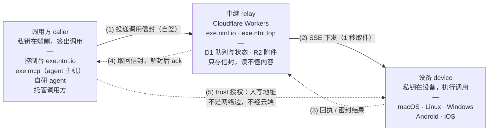

# eXe (Executable)

给任何 harness 一副手：接上一个 MCP，它就能操作你名下的所有设备——
执行 `shell`、读设备上的图片。身份只是一把 **Ed25519** 密钥，**公钥就是地址**。
人在调用方填设备地址、在设备上填调用方地址，此后云端投递的每一次调用都要通过设备本地
`trust` 列表里的地址验证，结果用同一把密钥派生的 X25519 封装后回传，云端只做信封中转。

> **术语**：**调用方**是产生调用的一方。**控制台**只是它的一个实现——`exe.ntnl.io` 上那个
> 浏览器应用；另一台跑 `exe mcp` 的机器、一个自研 agent，都是同等资格的调用方。

## 拓扑

调用方与设备之间**没有网络边**：两边都只连中继，方向永远由调用方发起，设备也没有「回调调用方」这条路。
把两者绑在一起的不是网络，而是设备 `trust` 里的那一行地址——由人写上去，中继那份副本只能让投递变少。



| # | 方向 | 传输 | 走什么 | 谁验谁 |
|---|---|---|---|---|
| (1) | 调用方 → 中继 | HTTPS，每次请求自签 | `POST /api/devices/{address}/calls` 投递调用信封 | 中继验签 + 时间窗 ±300 s |
| (2) | 中继 → 设备 | SSE 长连接，1 秒在 D1 里取一次件 | `GET /v1/devices/{address}/stream` 下发同一封信封 | 设备验签：`caller` 必须在 `trust` 里 |
| (3) | 设备 → 中继 | HTTPS，自签 | `received` 回执、密封 `result`，装不进一行时先传 `blob` | 中继只核 `call_id` 幂等，不解密 |
| (4) | 中继 → 调用方 | HTTPS，自签 | 状态与信封；调用方本地解封后 `ack`，中继立刻删掉这一行 | 调用方自己解封验签 |
| (5) | 调用方 ⇢ 设备 | **没有这条边** | 只有人写下的那两处地址 | 设备的 `trust` 是唯一权威 |

于是「调用者 / 被调用者」只有一层含义：**调用方是签得出这台设备接受的签名的地址，设备是执行并
签回结果的地址**。中继两侧看到的都只是地址、密文和签名——它不知道谁是谁，也不该知道。

- 设计约束：[`docs/SOUL.md`](docs/SOUL.md)
- 线协议：[`docs/PROTOCOL.md`](docs/PROTOCOL.md)
- 威胁模型与托管等级：[`docs/THREAT-MODEL.md`](docs/THREAT-MODEL.md)
- 中继传输决策（为什么是 SSE + D1 轮询）：[`docs/RELAY.md`](docs/RELAY.md)

## 组成

| 目录 | 东西 | 技术栈 |
|---|---|---|
| `worker/` | CF Worker：设备自登记、SSE 投递、结果收取、调用方 API | TypeScript（Workers native）+ D1 |
| `console/` | 控制台 GUI（Pages），无登录 | React + Vite + shadcn |
| `clients/crates/exe-core` | 协议 / 密码学（无平台假设） | Rust |
| `clients/crates/exe-cli` | 桌面 binary：既当设备，也当调用方（`exe mcp`） | Rust |
| `clients/android/` | Android app（JNI 复用 exe-core） | Rust + Kotlin |
| `clients/ios/` | iOS app（staticlib 复用 exe-core） | Rust + SwiftUI |
| `clients/macos/` | macOS 桌面客户端：**托管设备进程**，配置与权限都在这里 | SwiftUI |

## 把这台机器当作设备

```sh
curl -fsSL https://exe.ntnl.io/install.sh | sh   # Windows: irm https://exe.ntnl.io/install.ps1 | iex
exe                       # 建钥匙 → 装后台服务 → 启动 → 回报中继是否看得见
exe --trust <调用方地址>   # 同一件事，外加允许一个调用方
exe status                # 地址、调用方名单、服务状态、中继视角、日志路径
exe logs -f               # 服务没有终端，失败只能在这里看见
```

没有配对码，也没有需要批准的请求：信任的两个方向都是**填地址**。
`exe` 是幂等的，出问题第一个该敲的就是它。

设备默认常驻：Linux 写 `systemd --user`（并尝试 `enable-linger`），macOS 写 LaunchAgent
（必须在用户的 GUI 会话里，桌面才看得见），Windows 写登录触发的计划任务。
容器里没有 supervisor，那里用 `exe run` 前台跑。

## 用一个 MCP 连接操作所有设备

任何支持 MCP 的 harness（Claude Code、Codex、Cursor、自研 agent）都能用同一套工具，
不需要任何平台账号——调用方的身份就是它的私钥：

```sh
# 在跑 agent 的那台机器上
exe mcp init                 # 创建调用方密钥（~/.config/exe/mcp.toml），打印它的地址
#   把该地址加到每台设备： exe trust <地址>
claude mcp add exe -- exe mcp
```

`~/.config/exe/mcp.toml` 里写设备名与地址：

```toml
tool_prefix = "exe"
[devices]
macmini = "<设备地址>"
phone   = "<设备地址>"
```

| 工具 | 做什么 |
|---|---|
| `exe_devices` | 列出设备，以及它们是否已登记、是否在线 |
| `exe_bash` | 在**远端设备**上执行 shell（`device` / `command` / `cwd` / `timeout_seconds`） |
| `exe_image` | 读设备上的图片，作为图片交给模型（截图 → 看） |

工具名带前缀是刻意的：harness 把所有 server 的工具拍平成一张表，而每个 agent 本来就有
自己的 `bash`；裸名会被内建工具或先到的 server 遮蔽。

## 发布

客户端二进制在 GitHub Releases 上，控制台的「下载客户端」指向最新一版；安装脚本随发布一起
发（`/download/install.sh`，再由 `/install.sh` 转发）。macOS 上还有一个桌面客户端，它把设备进程托管进 `.app`（授权才能跨版本存活）：
`scripts/build-app.sh && open dist/exe.app`，见 [`docs/APP.md`](docs/APP.md)。

服务端部署、控制台开发与产物构建见 [`docs/DEPLOY.md`](docs/DEPLOY.md)。
